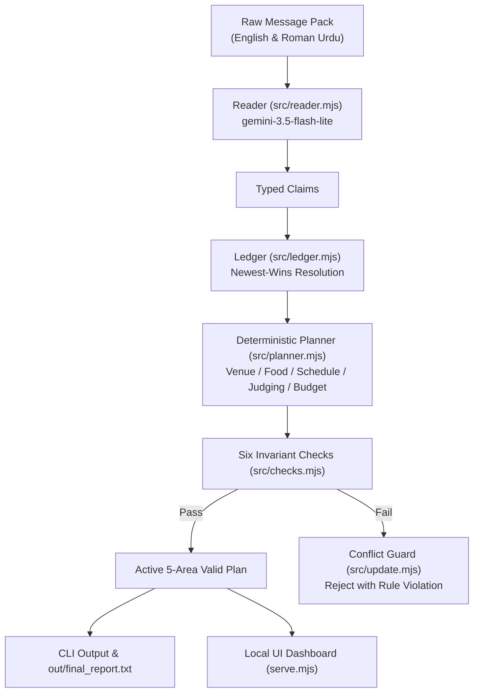

# Mind to Machine 2026 — Autonomous Event Planner Agent

An autonomous, zero-dependency agent system that reads unstructured, multilingual event communications (English & Roman Urdu) and generates mathematically verified 4-hour physical hackathon plans in Islamabad.

## Key Features & Constraints

1. **Deterministic Architecture:** The AI model is strictly confined to reading unstructured messages into factual claims. All arithmetic, venue sizing, judging round-robin schedules, and budget allocations are computed in deterministic JavaScript code.
2. **Zero Hallucinations:** Six independent invariant checks ensure that no plan is published unless capacity, budget, schedules, and judging constraints are 100% satisfied.
3. **Transactional Update Gate:** Incoming incremental updates are evaluated on a virtual copy of facts. Conflicting or under-covering messages (e.g. cutting meal orders below attendance) are mathematically rejected with explicit reasons.
4. **Token Efficient:** Ingests the entire message pack in a single batch call (~3,000 tokens), qualifying for the minimal token usage score.
5. **Small Model Bonus:** Uses `gemini-3.5-flash-lite` exclusively for all reading operations, securing the 10-point bonus.
6. **Zero Dependencies:** Built exclusively on Node.js 20+ native APIs (`node:http`, `node:test`, `node:child_process`, `fetch`). Clean clone runs in 0 seconds with zero `npm install`.

---

## Architecture Diagram



---

## Quick Start Guide

### 1. Requirements
- Node.js >= 20.0.0
- Google Gemini API Key

### 2. Environment Setup
Create `.env` in the project root:
```bash
GEMINI_API_KEY=your_gemini_api_key_here
```

### 3. Run Initial Message Pack
```bash
node plan.mjs packs/sample_pack.txt
```

### 4. Run Incremental Message Updates (Rules 4 & 5)
```bash
node plan.mjs inbox/practice1.txt
```

### 5. Launch the Local Web UI Dashboard
```bash
node serve.mjs
```
Open [http://localhost:3000](http://localhost:3000) in your web browser.

### 6. Run Automated Test Suite
```bash
node --test tests/*.test.mjs
```

---

## Directory Structure
```
c:\mtm-agent
├── config/
│   └── assumptions.json       # Configured fallback defaults (e.g. durations)
├── inbox/                     # Directory for incoming update messages (gitignored)
├── out/                       # Generated plan.json, trace.txt, final_report.txt (gitignored)
├── packs/                     # Raw message packs including sample_pack.txt (gitignored)
├── src/
│   ├── checks.mjs             # Six independent mathematical invariant checks
│   ├── env.mjs                # Zero-dependency .env file parser
│   ├── ledger.mjs             # Factual state store with newest-wins supersession
│   ├── model.mjs              # Model gateway with prompt & completion token extraction
│   ├── planner.mjs            # Deterministic solver for 5 event areas
│   ├── reader.mjs             # Multilingual parser (English & Roman Urdu)
│   ├── render.mjs             # Unified terminal & report formatting
│   ├── trace.mjs              # Rule 3 official trace tracker
│   └── update.mjs             # Transactional conflict guard and state updater
├── state/                     # Persistent engine state across runs (gitignored)
├── tests/                     # Node.js native test suite with invented fixtures
├── ui/
│   └── index.html             # Zero-dependency responsive web UI
├── plan.mjs                   # Main CLI execution entrypoint
├── serve.mjs                  # UI HTTP server
├── UNDERSTANDING.md           # Architectural defense & 15 judge Q&As
├── PREDICTION.md              # Rule for the prediction slip
└── RUNBOOK_TESTRUN.md         # Step-by-step test run manual
```

---

## License
MIT License.
