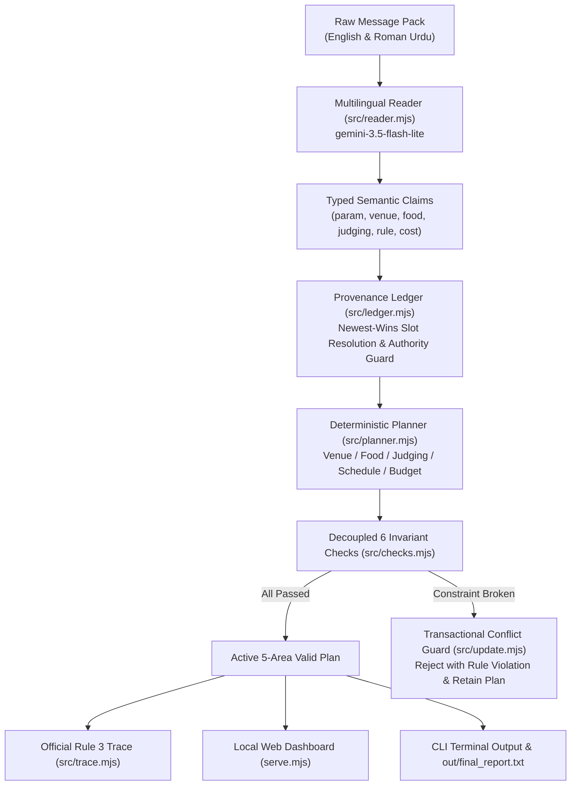

# Mind to Machine 2026 — Autonomous Event Planner Agent

[](https://github.com/MuhammadAhmedAli26/mtm-autonomous-event-planner)
[](https://nodejs.org/)
[-0284c7?style=for-the-badge)](https://nodejs.org/)
[](https://ai.google.dev/)
[](https://github.com/MuhammadAhmedAli26/mtm-autonomous-event-planner)
[](LICENSE)

An autonomous, zero-dependency, ultra-low-token agent system engineered for the **Mind to Machine 2026 Hackathon** (GDGoC CUI Wah). It ingests noisy, multilingual event communications (English, Roman Urdu, WhatsApp slang, official emails) and synthesizes a mathematically verified, constraint-satisfying 4-hour physical hackathon plan in Islamabad across five core areas: **Venue, Food, Judging, Budget, and Schedule**.

---

## 🌟 Key Architectural Highlights

1. **"LLM Reads, Deterministic Code Solves" (Zero Math Hallucinations):**
   - The LLM is strictly restricted to extracting semantic typed claims from unstructured language.
   - All arithmetic, capacity constraints, schedule contiguity, judging ratios, and budget allocations are calculated in deterministic JavaScript code.
2. **Minimalist Token Footprint (~2,900 Tokens Total):**
   - Ingests the entire initial message pack in a single batch pass.
   - 0 LLM tokens spent on arithmetic, timetable construction, or validation.
3. **Small Model Bonus (+10 Points):**
   - Powered by `gemini-3.5-flash-lite` (with zero-lag fallback to `gemini-flash-lite-latest`), satisfying the organizers' small-model criteria.
4. **Live Invariant Protection Gate (Rules 4 & 5):**
   - New messages (e.g. judges testing adversarial scenarios) are simulated on a ledger clone.
   - Conflicting inputs (e.g. reducing meal count below attendance or exceeding budget cap) are rejected with explicit mathematical reasoning, preserving the active plan intact.
5. **Decoupled Verification Suite (Rule 10):**
   - `src/checks.mjs` has exactly **zero dependencies or imports**, ensuring the planner never grades its own assertions.
6. **Zero External Dependencies:**
   - Runs exclusively on native Node.js 20+ built-ins (`node:http`, `node:test`, `node:crypto`, `node:child_process`, `fetch`).
   - Clean clone starts instantly in `< 6 seconds` with **zero `npm install`**.

---

## 🏛️ System Architecture



---

## 📊 The 5 Core Event Areas (Islamabad Hackathon)

| Area | Solver Logic | Output Summary |
| :--- | :--- | :--- |
| **1. Venue** | Capacity $\ge$ Headcount ($177$), selects lowest cost hall with mandatory generator feature | **Hall A** (200 seats, Rs 120,000, generator backup confirmed) |
| **2. Food** | Orders exact meals for $150 \text{ students} + 10 \text{ staff} + 17 \text{ judges} = 177$ attendees | **Standard lunch box** ($177$ boxes @ Rs 1,200/head = Rs 212,400, free delivery) |
| **3. Judging** | $\lceil 50 \text{ teams} / 3 \text{ max per judge} \rceil = 17$ judges required & assigned | **17 Judges** ($20$ confirmed available, Rs 5,000 honorarium = Rs 85,000, 3 parallel rounds) |
| **4. Budget** | Sum of Venue + Food + Judging + Committed Expenses $\le$ Cap (Rs 650,000) | **Rs 547,400 allocated** / Rs 650,000 cap (**Buffer: Rs 102,600**) |
| **5. Schedule** | 240-minute contiguous timeline with mandatory 15-min prayer break and parallel judging | **10:00 - 14:00** (Opening 15m, Sprint 135m, Prayer 15m, Judging 45m, Closing 30m) |

---

## 🚀 Quick Start Guide

### 1. Prerequisites
- Node.js >= 20.0.0
- Google Gemini API Key

### 2. Environment Configuration
Create a `.env` file in the project root:
```bash
GEMINI_API_KEY=your_gemini_api_key_here
```

### 3. Run Initial Event Plan
```bash
node plan.mjs packs/sample_pack.txt
```

### 4. Run Incremental Update / Adversarial Test
```bash
# Valid change: Printing cost updated to Rs 15k (Accepted -> Budget updates)
node plan.mjs inbox/practice1.txt

# Conflict test: Caterer cuts boxes to 100 (Rejected -> 100 < 177 headcount)
node plan.mjs inbox/practice2.txt
```

### 5. Launch the Interactive Web Dashboard
```bash
node serve.mjs
```
Open **[http://localhost:3000](http://localhost:3000)** in any modern web browser. Features:
- **Glowing Live Judge Verdict Banner:** Instant visual feedback (Emerald `ACCEPTED` / Crimson `REJECTED`).
- **One-Click Judge Presets:** Pre-configured buttons to test Practice 1, Practice 2, 10x Price Typos, and Missing Generators.
- **Audio Chimes:** Real-time synthesized dual-tone audio alert on message evaluation.
- **6/6 Invariant Status Grid:** Real-time visual pass indicators.
- **Execution Trace Viewer:** Monospace terminal viewer reporting exact model calls and token metrics.

---

## 🧪 Automated Test Verification

Run the complete native test suite across unit, adversarial, and invariant suites:
```bash
# Run all unit and invariant tests
node --test tests/*.test.mjs

# Verify exact Rule 3 token trace sum matches reported usageMetadata
node tests/check_trace.mjs

# Verify zero-dependency clean clone in isolated temp workspace
powershell -ExecutionPolicy Bypass -File scripts/test_clean_clone.ps1
```

---

## 📂 Repository Layout

```
C:\mtm-agent
├── config/
│   └── assumptions.json       # Configured fallback durations & slot tolerances
├── inbox/                     # Incoming incremental message queue
├── out/                       # Generated outputs (plan.json, trace.txt, final_report.txt, verdict.json)
├── packs/                     # Benchmark packs (sample_pack.txt & 6 regional variants)
├── scripts/
│   ├── test_clean_clone.ps1   # Automated clean clone and zero-dependency audit
│   └── test_serve.ps1         # Web server & API integration tester
├── src/
│   ├── checks.mjs             # 6 independent mathematical invariant verification rules
│   ├── env.mjs                # Lightweight zero-dependency .env reader
│   ├── ledger.mjs             # Provenance store with newest-wins supersession & role guards
│   ├── model.mjs              # Gemini REST client with exact usageMetadata token capture
│   ├── planner.mjs            # Deterministic solver across the 5 event areas
│   ├── reader.mjs             # Multilingual semantic claim parser (English & Roman Urdu)
│   ├── render.mjs             # Standardized terminal & report markdown formatter
│   ├── trace.mjs              # Rule 3 official trace recording engine
│   └── update.mjs             # Transactional state update gate with conflict rejection
├── state/                     # Persistent engine state across runs (gitignored)
├── tests/
│   ├── adversarial.test.mjs   # T2 edge-case and adversarial invariant test suite
│   ├── check_trace.mjs        # Strict mathematical token sum validator
│   ├── planner.test.mjs       # Pure solver unit tests
│   └── update.test.mjs        # Incremental update gate unit tests
├── ui/
│   └── index.html             # High-tech interactive judge dashboard with live verdict alerts
├── JUDGE_SCRIPT.md            # Master presentation pitch, walkthrough, and Q&A defense
├── UNDERSTANDING.md           # Exhaustive architectural breakdown & 15 judge Q&As
├── RUNBOOK_TESTRUN.md         # Step-by-step competition runbook
├── PREDICTION.md              # Domain prediction slip documentation
├── plan.mjs                   # Unified CLI runner
├── reset.mjs                  # Clean state reset utility
└── serve.mjs                  # Native HTTP web dashboard server
```

---

## 📖 Presentation Resources

- **[JUDGE_SCRIPT.md](JUDGE_SCRIPT.md):** Complete pitch script, 3-minute live demonstration steps, and 10 tricky judge defense questions with model answers in Roman Urdu & English technical terms.
- **[UNDERSTANDING.md](UNDERSTANDING.md):** Deep-dive architectural defense justifying why each module exists and what would fail if removed.

---

## 📜 License
MIT License. Developed for Mind to Machine 2026.
